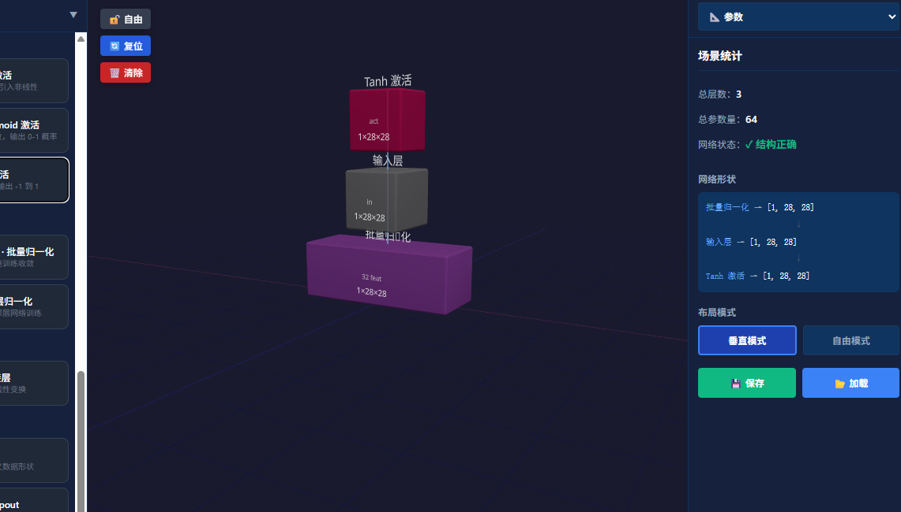
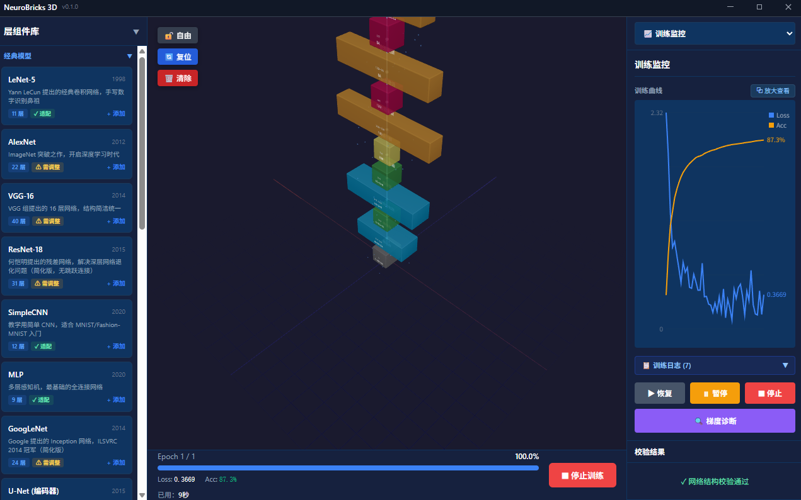
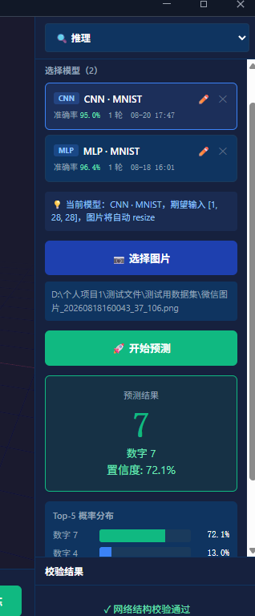

# NeuroBricks 3D

**Build neural networks with 3D blocks, validate tensor shapes in real time, and launch real PyTorch training.**

在 3D 空间里像搭积木一样搭建神经网络，实时校验张量形状，一键启动真实的 PyTorch 训练。

**[English](#english) | [中文](#中文)**

## 评审与开发快速入口 / Review quick start

> 本仓库当前源码是本次评审对象。截至 2026-10-25，GitHub Releases 只有 2026-08-20 的历史 Windows setup.exe 附件，尚未发布与当前源码对应的新便携 ZIP。旧安装程序不代表当前教学、课题与结果解读界面；不要用它替代本次源码验收。
>
> Review the current source for this submission. The existing August 20 installer is historical; no new portable ZIP matching this source has been published as of October 25, 2026.

| 你想做什么 / Goal | 入口 / Start here |
| --- | --- |
| 从源码启动、区分界面演示与真实训练 | [开发与评审指南](docs/开发与评审指南.md) |
| 了解第一次如何操作 | [快速上手与常见问题](docs/教学/01-快速上手与常见问题.md) |
| 准备课堂或现场演示 | [课堂与提交演示脚本](docs/教学/02-课堂与提交演示脚本.md) |
| 按编号检查功能 | [发布候选人工验收清单](docs/教学/03-发布候选人工验收清单.md) |
| 运行自动化验证 | [测试指南](TESTING.md) |

### 历史界面示意 / Historical screenshots

以下三张是仓库已有的历史界面截图，仅用于说明产品形态，不是本次新增功能的最新实测截图。当前布局与功能以从本次源码启动后的程序为准。





<!-- TODO: demo gif — place a ~60s screen recording at assets/demo.gif, then uncomment:

-->

---

<a id="english"></a>
## English

### What is NeuroBricks 3D?

NeuroBricks 3D is a Windows desktop workbench for one engineer running small-data, single-machine supervised-learning experiments. Build a network with layer components and classic-model presets arranged in network order; tensor shapes are inferred live, and every controlled run is organized as traceable Study → Experiment → Attempt → Claim evidence.

### Features

- **3D network building** — 12 layer types (Conv2D, MaxPool2D, AvgPool2D, Linear, ReLU, Sigmoid, Tanh, BatchNorm2d, LayerNorm, Dropout, Flatten, Input), automatically arranged in network order
- **8 classic model presets** — LeNet-5, AlexNet, VGG-16, ResNet-18, GoogLeNet, MLP, SimpleCNN, U-Net encoder (an encoder preset, not a segmentation promise)
- **Real-time shape validation** — tensor shapes propagate layer by layer; mismatches are highlighted with expected-vs-actual comparison and fix suggestions
- **Bounded supervised tasks** — image classification from MNIST / CIFAR-10 or custom class folders, plus CSV tabular regression (UTF-8 / GBK auto-detected)
- **Local PyTorch training** — capability-checked Python environment in source development; verified portable builds bundle their own runtime. Device selection is explicit; unavailable selected CUDA stops startup rather than silently switching to CPU
- **Trustworthy experiment records** — content fingerprints, sealed test sets, strict comparison groups, Attempt restart lineage, pre-registered claims, three-way statistical verdicts, confusion diagnostics, and append-only audit events
- **Training visualization** — live loss/accuracy or MAE curves, training logs, and variance-aware comparisons
- **Classification and regression inference** — image-model cards provide Top-5; CSV regression cards accept features in the recorded order, reuse training-set normalization, and return a single prediction
- **Live code panel** — see the PyTorch code update in real time as you build; one-click copy
- **One-way evidence export** — Study reports and experiment manifests preserve provenance/trust labels; modified external reruns never inherit controlled-execution trust

### Deliberate boundary

The current product promise is **small datasets, one Windows machine / one consumer GPU, supervised learning**. It supports image classification and bounded CSV regression. It deliberately does not promise detection, segmentation, multi-label classification, LLM fine-tuning, multimodal pipelines, clusters, multi-GPU scheduling, or cloud multi-tenancy.

### Tech Stack

| Layer | Technology | Notes |
| --- | --- | --- |
| App shell | Tauri v1 | Lightweight desktop shell, Rust backend |
| Frontend | React 18 + TypeScript | UI and state management |
| 3D rendering | React Three Fiber + Three.js | 3D scene and block rendering |
| State | Zustand | Lightweight reactive stores |
| Build | Vite | Frontend dev & build |
| Backend | Rust | Process management, filesystem, event bridge |
| Training engine | Python + PyTorch | Bundled sidecar, CUDA support |
| Packaging | PyInstaller + Tauri portable build | Self-contained Windows x64 application package |

### Install

For this submission, follow the [source development and review guide](docs/开发与评审指南.md). [Releases](https://github.com/nanliuqi/neurobricks-3d/releases) currently provides only the historical August 20, 2026 setup.exe; it is not the current source version. No matching new portable ZIP is linked here because one has not yet been published.

The portable distribution workflow is retained for future builds: extract the complete ZIP, then run `NeuroBricks 3D.exe`. Verified portable builds contain their own training runtime; source clones do not. Compatible NVIDIA drivers are needed for GPU training; select CPU explicitly when appropriate. If a selected CUDA device becomes unavailable, startup is rejected and asks for device reselection.

> System requirements: Windows 10/11 (64-bit)

### Development

Prerequisites: Node.js >=20 (22/24 recommended; checked with 24.16.0). Desktop development additionally needs the Rust MSVC toolchain, Windows C++ Build Tools/SDK and WebView2. A fresh source clone needs a working 64-bit Python 3.12 environment with the sidecar requirements for real training; Python is also required to rebuild the release sidecar.

```bash
git clone https://github.com/nanliuqi/neurobricks-3d.git
cd neurobricks-3d

npm ci               # install the locked frontend dependencies
npm run dev          # browser UI simulation; does not start Python
# Configure Python as documented in the guide before real desktop training:
npm run tauri -- dev # desktop development; not browser simulation
```

See the [guide](docs/开发与评审指南.md) for `.venv`, `NEUROBRICKS_PYTHON`, capability checks, dataset downloads, tests and packaging. Development selects only a capability-checked runtime. `npm run package:windows` separately creates and verifies an isolated, version-pinned CUDA sidecar before building the portable app; it does not borrow an end user's Python.

### Roadmap

- [x] Strict Study / Experiment / Attempt / Claim evidence chain
- [x] Sealed-test claim adjudication and confusion diagnostics
- [ ] Cluster/block bootstrap for correlated group or temporal samples
- [ ] Understanding engine — feature map visualization

Task gamification and SSH training remain backlog ideas, not current product commitments.

### License

[MIT](LICENSE) © nanliuqi

---

<a id="中文"></a>
## 中文

### NeuroBricks 3D 是什么？

一款服务于“小数据、单机单卡、监督式学习”的 Windows 实验工作台，面向小团队里一个人扛起 AI 模块的工程师。通过层组件库和经典模型预设构建按网络顺序排列的 3D 结构，张量形状实时推导；每次受控训练则自动进入 Study → Experiment → Attempt → Claim 的可追溯证据链。

### 功能特性

- **3D 积木搭建** — 12 种层类型（Conv2D、MaxPool2D、AvgPool2D、Linear、ReLU、Sigmoid、Tanh、BatchNorm2d、LayerNorm、Dropout、Flatten、Input），按网络顺序排列
- **8 个经典模型预设** — LeNet-5、AlexNet、VGG-16、ResNet-18、GoogLeNet、MLP、SimpleCNN、U-Net 编码器（仅编码器预设，不承诺分割任务）
- **实时形状校验** — 张量形状逐层推导，参数不匹配时红色高亮 + 期望/实际对比 + 修复建议
- **有边界的监督任务** — MNIST / CIFAR-10 与自定义类别文件夹用于图像分类；CSV 用于表格监督回归（UTF-8 / GBK 自动识别）
- **本地 PyTorch 训练** — 源码开发使用通过能力探测的 Python 环境，已验证便携构建使用独立内置运行时；设备明确选择，已选 CUDA 失效时拒绝启动而非静默降级
- **可信实验档案** — 数据内容指纹、封存测试集、严格可比分组、Attempt 重启谱系、主张预注册、三值统计裁决、混淆诊断与只追加审计
- **训练可视化** — 实时 Loss/Accuracy 或 MAE 曲线、训练日志与带方差提示的实验对比
- **分类与回归推理** — 图像分类卡片提供 Top-5；CSV 回归卡片按训练时特征顺序接收原始数值并复用训练集标准化参数，输出单一预测值
- **实时代码面板** — 搭积木的同时实时查看对应 PyTorch 代码，一键复制
- **单向证据导出** — Study 报告与实验 manifest 保留来源和可信等级；导出后修改并在外部重跑不会继承受控执行身份

### 刻意边界

当前产品承诺锁在 **小数据集、Windows 单机单张消费级显卡、监督式学习**：做深图像分类与有界 CSV 回归；明确不承诺检测、分割、多标签分类、LLM 微调、多模态、集群、多 GPU 调度或云多租户。

### 技术栈

| 层级 | 技术 | 说明 |
| --- | --- | --- |
| 应用外壳 | Tauri v1 | 轻量桌面壳，Rust 后端 |
| 前端 | React 18 + TypeScript | UI 与状态管理 |
| 3D 渲染 | React Three Fiber + Three.js | 三维场景与积木渲染 |
| 状态管理 | Zustand | 轻量响应式 store |
| 构建工具 | Vite | 前端开发与构建 |
| 后端 | Rust | 进程管理、文件系统、事件桥接 |
| 训练引擎 | Python + PyTorch | 内置 sidecar，支持 CUDA |
| 打包 | PyInstaller + Tauri 便携构建 | 自包含 Windows x64 应用包 |

### 安装

本次请按[开发与评审指南](docs/开发与评审指南.md)从源码启动。[Releases](https://github.com/nanliuqi/neurobricks-3d/releases) 截至 2026-10-25 仅有 2026-08-20 的历史 Windows setup.exe，不能代替当前源码；当前没有与本次源码对应的新便携 ZIP 下载入口。

保留的便携分发流程用于后续构建：完整解压 ZIP，再运行 `NeuroBricks 3D.exe`。已验证便携构建包含独立训练运行时，最终用户无需安装 Python；源码克隆不含此运行时。GPU 训练需要兼容的 NVIDIA 驱动，也可明确选择 CPU；已选 CUDA 不可用时须重新选择设备，不会静默改用 CPU。

> 系统要求：Windows 10/11（64 位）

### 开发环境

前置要求：Node.js >=20（推荐 22/24，已在 24.16.0 检查）。桌面开发还需 Rust MSVC 工具链、Windows C++ Build Tools/SDK 和 WebView2。源码克隆后进行真实训练或重建发布 sidecar，均需可用的 64 位 Python 3.12 与相应依赖。

```bash
git clone https://github.com/nanliuqi/neurobricks-3d.git
cd neurobricks-3d

npm ci               # 按锁文件安装前端依赖
npm run dev          # 浏览器 UI 模拟，不启动 Python
# 按指南配置 Python 后，再进行真实桌面训练：
npm run tauri -- dev # 桌面开发，不是浏览器模拟
```

`.venv`、`NEUROBRICKS_PYTHON`、能力探测、数据下载、测试和打包步骤见[详细指南](docs/开发与评审指南.md)。开发模式只采用通过能力探测的运行时；`npm run package:windows` 则单独创建并校验隔离、锁版本的 CUDA sidecar，再构建便携应用，不借用最终用户电脑上的 Python。

### 路线图

- [x] Study / Experiment / Attempt / Claim 严格证据链
- [x] 封存测试集主张裁决与混淆诊断
- [ ] 面向 group/temporal 相关样本的 cluster/block bootstrap
- [ ] 理解引擎 — feature map 可视化

任务游戏化与 SSH 云训练只保留在 backlog，不属于当前产品承诺。

### 许可证

[MIT](LICENSE) © nanliuqi

---

如果这个项目对你有帮助，欢迎 ⭐ Star 支持一下！ / If you find this project useful, a ⭐ is much appreciated!
